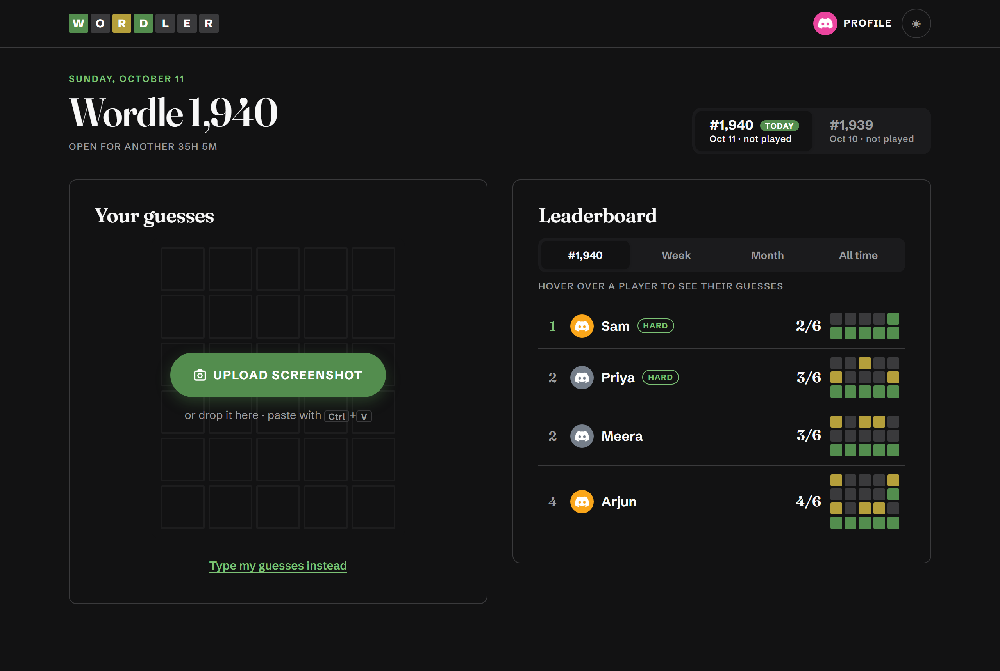
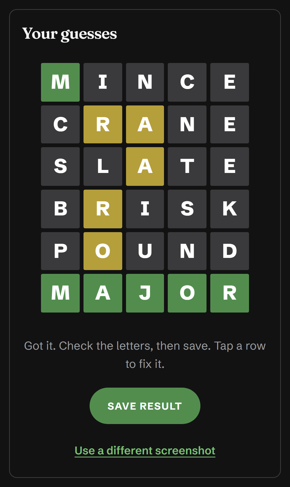
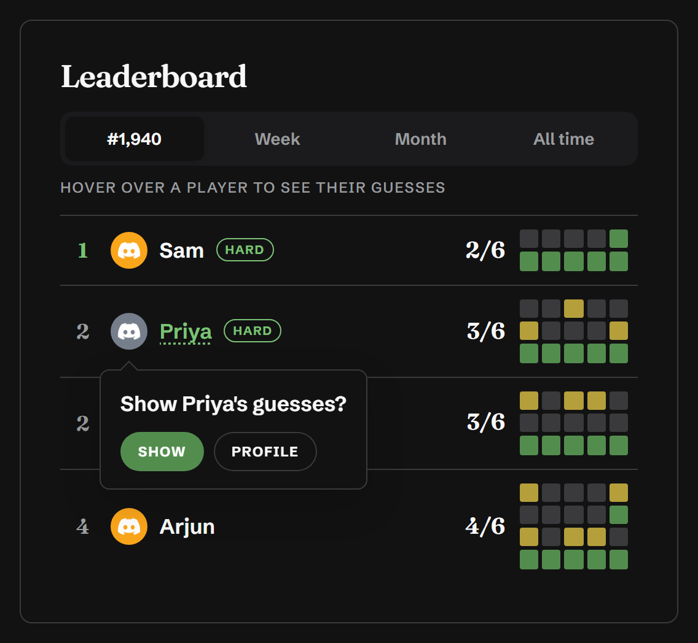
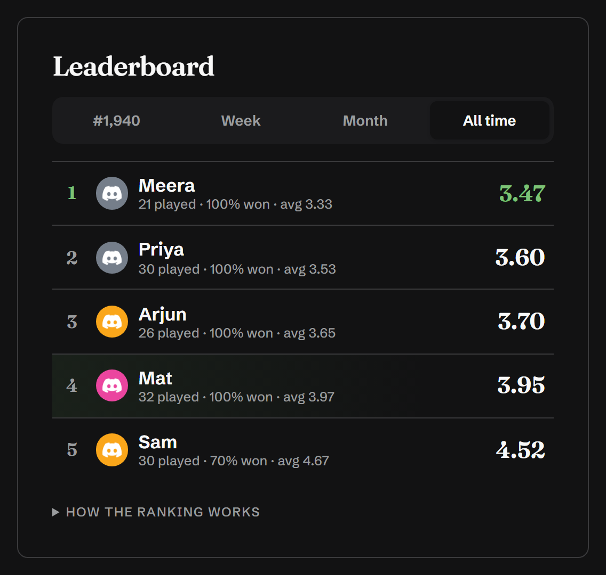
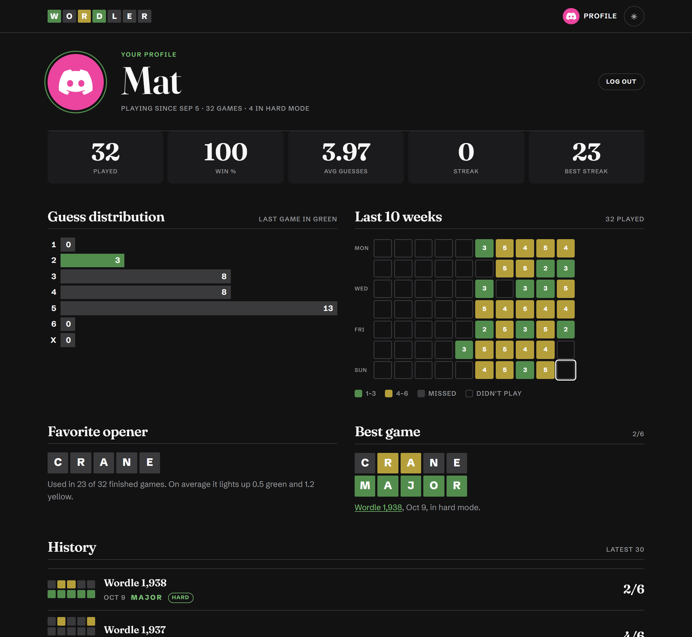

# Wordler

A Wordle leaderboard for a group of friends.

You play Wordle like normal on the New York Times site or app. Then you drop a
screenshot of your finished board onto Wordler, and it adds your result to the
leaderboard. That's it.

**Live site:** https://wordle.shreyashrai.com



<sub>Screenshots use made-up players.</sub>

---

## What you can do

### Upload a screenshot

Tap **Upload screenshot**, drop the image on the page, or paste it with Ctrl+V.
Wordler reads the colors and letters and shows you the board. Check it and
press **Save**. If a letter came out wrong, tap that row and type the word.
You can also skip the screenshot and type your guesses.

<p align="center">
  
</p>

### See who did best

The leaderboard has four tabs: today's puzzle (ranked by number of guesses),
**Week**, **Month** and **All time**.

Everyone's colored squares are always visible. To see someone's actual words,
tap or hover over their name. It asks **"Show guesses?"** first, so nobody gets
spoiled by accident.

<p align="center">
  
  
</p>

### Share it in Discord

After you save, **Copy for Discord** copies your result in the usual Wordle
style, with each word hidden behind a Discord spoiler:

```
Wordle 1,940 3/6

⬛⬛🟨⬛⬛ ||`SLATE`||
🟨⬛⬛⬛🟨 ||`ADIEU`||
🟩🟩🟩🟩🟩 ||`UNCAP`||
```

### Check your profile

Games played, win rate, average guesses, streaks, a calendar of the last 10
weeks, your favorite opening word, your best game and your history.



You log in with Discord. Nothing gets added to anyone's Discord server: no bots,
no webhooks. Sharing results is just copy and paste.

---

## How a few things work

### Reading screenshots

1. Wordler finds the board in your picture and reads each tile's color straight
   from the pixels. Wordle's colors never change, so this part is exact.
2. It reads the letters with free text recognition (Tesseract) that runs in your
   browser. Your screenshot never gets uploaded anywhere.
3. When you save, the server double-checks every row. If a letter was misread,
   it picks the one real word that gives exactly the colors in your screenshot.
   So a misread "WOOYY" becomes "WOOZY".
4. If you pasted a board on the wrong puzzle's tab, Wordler notices and saves it
   to the right puzzle.

Your web browser never learns the day's answer. Only the server checks guesses.

### The rankings

- **Today's puzzle:** fewest guesses wins. Ties share a place.
- **Week, Month, All time:** ranked by a **rating**. It's your average number of
  guesses (a miss counts as 7), adjusted for how many games you've played.
  Everyone starts out counted as average and moves toward their real average
  the more they play. That way one lucky 2/6 can't put a new player on top.
  Lower is better.
- To be ranked you need **3 games** in the week, **5** in the month, or **7**
  overall. Until then you're listed under "Not ranked yet".

### Days and time zones

- Every Wordle has a number (like #1,940), and that number is the same
  everywhere. Wordler shows numbers instead of "today" and "yesterday", so
  friends in different countries are always talking about the same puzzle.
- Each puzzle stays open for 50 hours, from when it starts anywhere in the world
  until it ends everywhere: 12:00 UTC the day after its date. That gives people
  in every time zone a fair chance.
- The site opens on the puzzle for your own date, the same one the NYT gives you.
- Week and month boards follow the UTC date, so everyone sees the same boards.
  Weeks run Monday to Sunday.

---

## Built with

- [Astro](https://astro.build), the same framework as
  [shreyashrai.com](https://shreyashrai.com), whose fonts it borrows
- [Cloudflare Pages](https://pages.cloudflare.com) for hosting
- [Cloudflare D1](https://developers.cloudflare.com/d1/), a small hosted database
- [Tesseract.js](https://tesseract.projectnaptha.com) for reading letters
- Discord login (just your name and avatar)

It all runs on Cloudflare's free plan.

---

## Run it on your computer

You need [Node.js](https://nodejs.org) (version 20 or newer).

1. Install everything:
   ```sh
   npm install
   ```
2. Make your settings file:
   ```sh
   cp .dev.vars.example .dev.vars
   ```
   Open `.dev.vars` and fill it in:
   - `DISCORD_CLIENT_ID` and `DISCORD_CLIENT_SECRET`: from the
     [Discord Developer Portal](https://discord.com/developers/applications).
     Make an app, open **OAuth2**, and add
     `http://localhost:4321/auth/callback` as a redirect.
   - `SESSION_SECRET`: any long random text. This makes one:
     `node -e "console.log(crypto.randomUUID()+crypto.randomUUID())"`
   - `ALLOWED_DISCORD_IDS` (optional): Discord user IDs, separated by commas,
     if you only want certain people to log in.
3. Set up the local database:
   ```sh
   npm run db:migrate:local
   ```
4. Start it:
   ```sh
   npm run dev
   ```
   Open http://localhost:4321.

The local database is a file inside `.wrangler/` and has nothing to do with the
live one, so you can mess around freely.

---

## Deployment

### How it's hosted

```
 Browser ──► Cloudflare Pages ──► Cloudflare D1
              (the site and its      (players, puzzles,
               server code)           everyone's guesses)
                    │
                    ├──► Discord      (only to log people in)
                    └──► NYT          (fetches each day's answer once)
```

| What | Where |
| --- | --- |
| Site | Cloudflare Pages project `wordler`, at https://wordle.shreyashrai.com (also https://wordler-dap.pages.dev) |
| Database | Cloudflare D1 database `wordler`, in Cloudflare's Asia-Pacific region |
| Settings | `wrangler.toml` (the database link) and secrets stored in Cloudflare |
| Code | This repo. Pushing here does **not** update the site; run the deploy command below. |

### Putting changes live

```sh
npm run deploy
```

That builds the site and uploads it. It's live in under a minute.

If you changed the database tables (added a file in `migrations/`), run this
**before** deploying:

```sh
npm run db:migrate:remote
```

### Secrets

These live in Cloudflare, never in the code. To change one:

```sh
npx wrangler pages secret put <NAME> --project-name wordler
```

then run `npm run deploy` again.

| Secret | What it's for |
| --- | --- |
| `DISCORD_CLIENT_ID` | Your Discord app's ID, for login |
| `DISCORD_CLIENT_SECRET` | Your Discord app's secret, for login |
| `SESSION_SECRET` | Random text that signs the login cookie. Changing it logs everyone out. |
| `ALLOWED_DISCORD_IDS` | Optional. Only these Discord users can log in. Not set means anyone can. |

### Looking at the live data

- In the Cloudflare dashboard: **Storage & Databases → D1 → wordler**.
- From the terminal:
  ```sh
  npx wrangler d1 execute wordler --remote --command "SELECT * FROM submissions"
  ```
- D1 keeps a history of the database (Time Travel), so you can roll back a
  mistake from the last few days.

### Setting it all up from scratch

On a new Cloudflare account:

1. `npx wrangler login`
2. `npx wrangler d1 create wordler`, then paste the `database_id` it prints
   into `wrangler.toml`. Then run `npm run db:migrate:local` once, because your
   local database is tied to that ID too.
3. `npm run db:migrate:remote`
4. `npx wrangler pages project create wordler --production-branch main`
5. Add the three required secrets from the table above.
6. `npm run deploy`
7. In the Discord Developer Portal, add `https://<your-site>/auth/callback` as a
   redirect.
8. Optional: in the Cloudflare dashboard, go to **Workers & Pages → wordler →
   Custom domains** and add your own domain.

### If something breaks

- **Every page just says `[object Object]`:** the `compatibility_date` in
  `wrangler.toml` was moved to 2025-09-15 or later. Keep it earlier. Newer dates
  make Cloudflare look like Node.js to Astro, and the pages break. (The local
  dev server doesn't show this problem, so check the live site after deploying.)
- **"No such table" errors locally:** run `npm run db:migrate:local`.
- **Login fails:** check that `https://<your-site>/auth/callback` is listed under
  **OAuth2 → Redirects** in your Discord app.

---

## Where things are

| File or folder | What's in it |
| --- | --- |
| `src/pages/index.astro` | The home page: upload on the left, leaderboard on the right |
| `src/pages/u/[id].astro` | Player profiles |
| `src/pages/puzzle/[no].astro` | One puzzle's results (linked from profiles) |
| `src/lib/wordle.ts` | The rules: puzzle numbers, open times, colors, hard mode, checking guesses |
| `src/lib/screenshot.ts` | Finding the board in a screenshot |
| `src/scripts/ocr.ts` | Reading the letters in the browser |
| `src/lib/rank.ts` | How the week, month and all-time rankings are worked out |
| `src/lib/share.ts` | The "Copy for Discord" text |
| `src/lib/db.ts` | Everything that talks to the database |
| `migrations/` | The database tables |
| `src/styles/global.css` | All the styling |
| `docs/screenshots/` | The pictures in this README |

---

## Not built yet

- Skill and luck scores for each game (how good your guesses were, beyond just
  the count).
